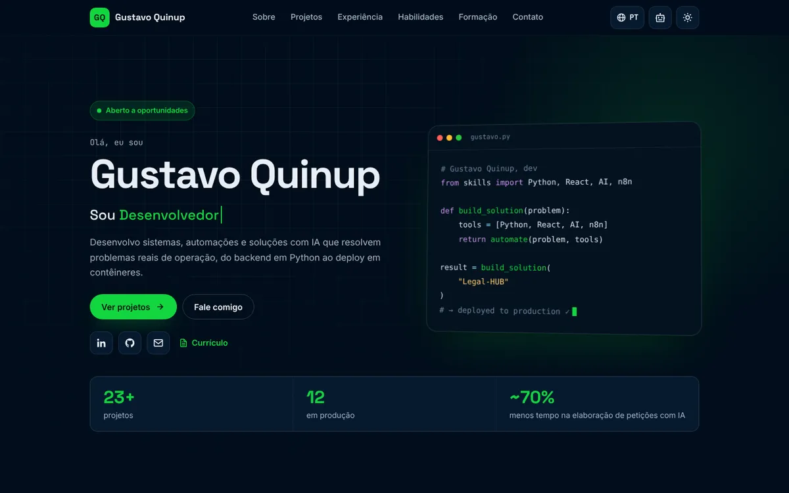

# Portfólio | Gustavo Quinup

> https://me.gaqtech.dev

Portfólio pessoal bilíngue (português e inglês), feito com [Astro](https://astro.build) e publicado no GitHub Pages com domínio próprio.

<p>
  
  
</p>


## Recursos

- Layout pensado primeiro para o celular
- Português e inglês, com URLs próprias (`/` e `/en/`) e tags `hreflang`
- Tema claro e escuro, seguindo a preferência do sistema
- Projetos em destaque (carrossel) e catálogo com filtros e 3 projetos por página
- Uma página de estudo de caso para cada projeto (`/projetos/<slug>/`)
- Formulário de contato com [Web3Forms](https://web3forms.com)
- Versão para IA: `/llms.txt`, `/llms-full.txt`, `/portfolio.md` e a página `/ia/`
- Dados estruturados (schema.org), sitemap, robots.txt e imagem de compartilhamento
- Zero framework de UI no cliente: só HTML, CSS e alguns scripts pequenos

## Rodando localmente

```bash
npm install
npm run dev      # http://localhost:4321
npm run build    # verifica tipos e gera o site em dist/
npm run preview  # serve o dist/
```

Requer Node.js 22.12 ou mais novo.

## Como editar o conteúdo

Guia completo, passo a passo: [COMO-ATUALIZAR.md](COMO-ATUALIZAR.md).

| O quê | Onde |
|---|---|
| Projetos | `src/content/projects/<slug>.yaml` (um arquivo por projeto) |
| Sobre, experiência, formação, certificações, habilidades | `src/data/profile.ts` |
| Textos da interface (botões, títulos) | `src/i18n/ui.ts` |
| E-mail, redes, link do currículo, GA4, chave do Web3Forms | `site` em `src/data/profile.ts` |

### Adicionar um projeto

1. Copie um arquivo de `src/content/projects/` e renomeie. O nome do arquivo vira a URL.
2. Preencha os blocos `pt` e `en`, a `category` (`app` ou `tool`), o `status` (`production`, `development` ou `completed`), o `order`, o `icon` ([Boxicons](https://boxicons.com), ex.: `bx-car`) e o `hue` (cor da capa, de 0 a 360).
3. Use `featured: true` para aparecer nos destaques e `private: true` para projetos com código privado.
4. Opcional: coloque imagens em `src/assets/projects/<slug>/` e liste-as em `screenshots` (ou use `cover`).

O `npm run build` valida todos os campos e avisa se algo estiver faltando.

## Deploy

Todo push na `master` roda `.github/workflows/deploy.yml`, que gera o site e publica no GitHub Pages.
Em **Settings → Pages**, a origem precisa estar em **GitHub Actions**.

## Licença

MIT
